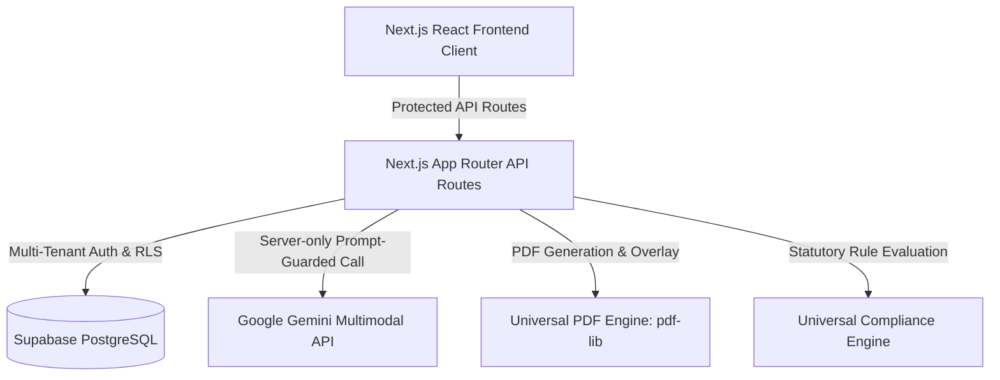

# Architecture Overview

## 1. System Design Principles

The Universal AI Document Platform is structured around an industry-agnostic document and compliance core, with profession-specific workflows provided via configurable modules.

## 2. Multi-Tenant SaaS Architecture

Tenant isolation is enforced through database schema design and logical isolation:

- **Organisation Account Boundary**: Every business tenant has a unique UUID `organisation_id`.
- **Row Level Security (RLS)**: PostgreSQL evaluates `get_auth_user_org_ids()` on every read/write operation. Non-members cannot read, write, or delete tenant records.
- **Role Hierarchy**:
  - `platform_admin`: Super-admin across the infrastructure.
  - `org_owner`: Complete administrative and billing authority for the tenant.
  - `org_admin`: Team lead and template management.
  - `staff`: Case officers, brokers, and paralegals processing client files.
  - `compliance_officer`: Reviews compliance exceptions and issues approvals.
  - `client_portal`: Restricted access to client's own submitted documents (privilege-isolated).

## 3. Universal PDF Engine

The PDF engine (`UniversalPdfEngine`) provides dual-mode processing:
1. **Interactive AcroForms**: Inspects PDF widget dictionaries, fills matching fields (`PDFTextField`, `PDFCheckBox`, `PDFDropdown`), and standardises output.
2. **Flat Coordinate Placement**: Uses standard PDF 72-DPI point coordinates `(x, y)` to overlay text and symbols onto scanned or non-interactive documents.
3. **Draft Watermarking**: Dynamically adds semi-transparent diagonal legal warnings to draft outputs.

## 4. Multimodal AI Extraction Layer

The AI integration abstracts document extraction behind `IDocumentExtractionProvider`:
- Server-side execution only (API keys never exposed to client).
- Documents are parsed as untrusted input with strict system constraints.
- Output JSON schema mandates field keys, extracted values, source pages, confidence scores, and evidence quotations.
- Deterministic fallback allows full offline and test execution without external API dependencies.
